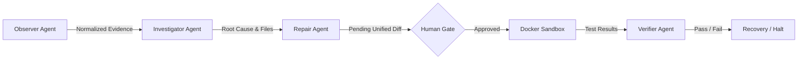
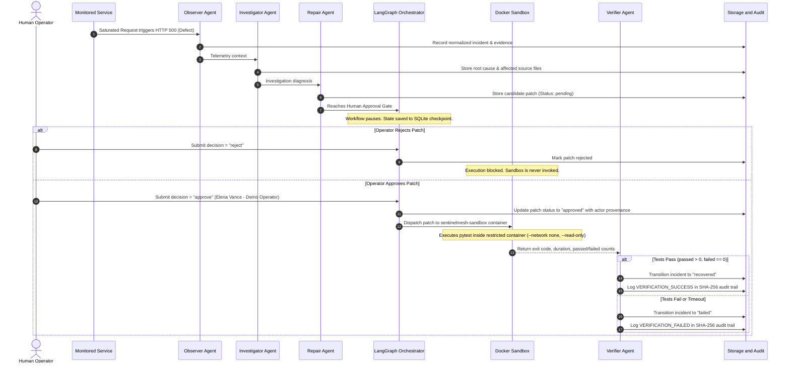
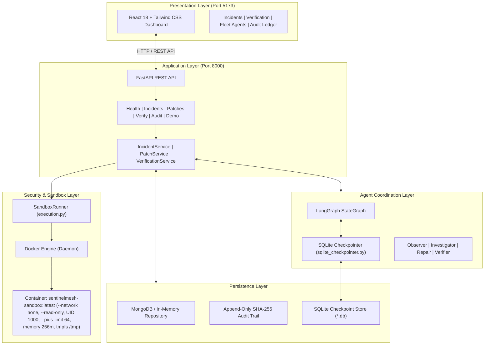

# 🛡️ SentinelMesh AI

### AI-Powered Multi-Agent Software Incident Detection, Investigation, Repair, and Verification Platform

<p align="center">
  <b>Detect. Investigate. Repair. Verify.</b>
</p>

<p align="center">
  <i>Building trustworthy, evidence-backed software recovery through collaborative AI agents and isolated container verification.</i>
</p>

<p align="center">
  
  
  
  
  
  
  
</p>

---

## 📑 Table of Contents

- [1. Project Overview](#1-project-overview)
- [2. Problem Statement](#2-problem-statement)
- [3. Proposed Solution](#3-proposed-solution)
- [4. Key Features](#4-key-features)
- [5. Multi-Agent Architecture](#5-multi-agent-architecture)
- [6. Complete Incident Lifecycle](#6-complete-incident-lifecycle)
- [7. System Architecture](#7-system-architecture)
- [8. Technology Stack](#8-technology-stack)
- [9. Project Repository Structure](#9-project-repository-structure)
- [10. Prerequisites](#10-prerequisites)
- [11. Installation and Setup](#11-installation-and-setup)
- [12. Environment Configuration](#12-environment-configuration)
- [13. Starting the Application](#13-starting-the-application)
- [14. Running Automated Tests](#14-running-automated-tests)
- [15. Executing the Live Demonstration](#15-executing-the-live-demonstration)
- [16. REST API Reference](#16-rest-api-reference)
- [17. Docker Sandbox Security Architecture](#17-docker-sandbox-security-architecture)
- [18. Human-in-the-Loop Governance](#18-human-in-the-loop-governance)
- [19. Persistence and State Checkpointing](#19-persistence-and-state-checkpointing)
- [20. Controlled Demonstration Results](#20-controlled-demonstration-results)
- [21. Implementation Status](#21-implementation-status)
- [22. Known Limitations and Future Roadmap](#22-known-limitations-and-future-roadmap)
- [23. Contributing](#23-contributing)
- [24. License](#24-license)
- [25. Team and Credits](#25-team-and-credits)

---

## 1. Project Overview

**SentinelMesh AI** is an AI-powered multi-agent software incident detection, investigation, repair, and verification system. The current implementation demonstrates the complete lifecycle using a controlled demonstration microservice (`demo-api`), coordinating four specialized AI agents to monitor telemetry, pinpoint root causes, propose constrained source code patches, enforce mandatory human sign-off, execute patches inside a restricted Docker container, and verify recovery through automated regression testing.

Traditional incident response requires engineers to manually triage logs, isolate broken code, synthesize fixes, and run regression suites under high pressure. While large language models can generate plausible code modifications, **a generated fix is not necessarily a correct fix**. Deploying unverified AI code directly into production introduces severe risks of regressions, data loss, and cascading outages.

SentinelMesh AI addresses this critical reliability gap through a fundamental architectural principle:

> **Finding a candidate fix is insufficient. The system must execute independent tests in an isolated sandbox to prove that the fix resolves the defect without regressions.**

---

## 2. Problem Statement

Modern software architectures suffer from recurring incident management challenges:

1. **Disconnected Tooling**: Logs, metrics, source repositories, pull requests, and test runners reside in disparate systems, forcing manual context-switching.
2. **Hallucinated or Flawed AI Fixes**: Coding assistants generate code without execution awareness. Synthetic fixes frequently fail edge cases or break unrelated features.
3. **Absence of Independent Verification**: AI tools rarely test their own patches against deterministic test suites in isolated runtimes.
4. **Unsafe Autonomous Execution**: Allowing autonomous agents to apply code directly to host filesystems or production clusters risks catastrophic compromise.
5. **Lack of Audit Custody**: Incident investigations often lack tamper-evident chronological records of who approved what code change and what test suite validated it.

---

## 3. Proposed Solution

SentinelMesh AI introduces an end-to-end, multi-agent control loop with strict security boundaries:

```
Detect ➔ Investigate ➔ Repair ➔ Human Approval Gate ➔ Isolated Sandbox ➔ Verify ➔ Recover
```

* **Specialized Agent Collaboration**: Division of labor between Observer, Investigator, Repair, and Verifier agents prevents single-agent blind spots.
* **Mandatory Human-in-the-Loop Gate**: Autonomous execution halts before patch application. Only authenticated human sign-off can release a patch to the sandbox.
* **Isolated Container Sandbox**: Untrusted patch code executes strictly within an ephemeral, unprivileged Docker container with zero network access and read-only filesystem mounts.
* **Deterministic Verification**: Recovery is declared only when independent pytest suites pass (exit code 0, passed > 0, failed = 0).
* **Crash-Resilient State**: Persistent SQLite checkpointing preserves pending approval states across backend restarts and process recycles.

---

## 4. Key Features

- **Automated Telemetry Ingestion**: Normalizes stack traces, error messages, and log streams into structured incident evidence.
- **Evidence-Grounded Diagnosis**: Investigator isolates root causes and correlates affected source files with confidence ratings.
- **Constrained Patch Synthesis**: Repair agent generates minimal unified diffs confined to an allowlist of target files (`PERMITTED_FILE_ALLOWLIST`).
- **Human Approval Checkpoint**: Pauses LangGraph execution, preventing patch execution without human operator sign-off.
- **Hardened Docker Sandbox**: Runs containers with `--network none`, `--read-only`, `--user 1000:1000`, `--cap-drop ALL`, `--pids-limit 64`, and `--memory 256m`.
- **Fail-Closed Verification Engine**: Zero tests, failed assertions, execution timeouts, or Docker engine outages immediately fail closed, blocking false recovery.
- **Persistent State Checkpointing**: Resumes suspended approval workflows from disk after backend restarts without re-running earlier steps.
- **Cryptographic Audit Ledger**: Tamper-evident SHA-256 hash-chained audit trail records all lifecycle events (`INCIDENT_REGISTERED`, `PATCH_APPROVED`, `VERIFICATION_SUCCESS`).
- **Real-Time Interactive Dashboard**: React/Tailwind frontend provides live incident triage, diff review, telemetry inspection, and audit ledger tracking.

### Application Interface and Screenshots

| Interface View | Asset Path | Status | Description |
| :--- | :--- | :--- | :--- |
| **System Dashboard** | `docs/assets/screenshots/dashboard.png` | `Placeholder` | <!-- TODO: Capture http://localhost:5173/ showing incident metrics, active fleet agent cards, and system status --> System metrics, fleet health, and incident timeline |
| **Incident Triage & Evidence** | `docs/assets/screenshots/incidents.png` | `Placeholder` | <!-- TODO: Capture http://localhost:5173/ with an active incident showing normalized stack traces and evidence --> Normalized error signatures and telemetry evidence |
| **Human Approval & Patch Review** | `docs/assets/screenshots/patch-review.png` | `Placeholder` | <!-- TODO: Capture http://localhost:5173/ showing proposed patch diff, file allowlist validation, and approve/reject actions --> Side-by-side diff review and human sign-off gate |
| **Docker Sandbox Verification** | `docs/assets/screenshots/verification.png` | `Placeholder` | <!-- TODO: Capture http://localhost:5173/ showing container execution log, duration, and pytest pass results --> Isolated container test execution and regression logs |
| **Cryptographic Audit Trail** | `docs/assets/screenshots/audit-logs.png` | `Placeholder` | <!-- TODO: Capture http://localhost:5173/ showing chronological SHA-256 hash-chained audit records --> Chronological, hash-chained audit ledger |

<!-- NOTE: Place actual full-resolution PNG captures in the `docs/assets/screenshots/` directory using the filenames above. -->

---

## 5. Multi-Agent Architecture

SentinelMesh AI deploys four specialized agents coordinated through a central LangGraph state graph.



### 5.1 Observer Agent
* **Domain**: Telemetry ingestion and evidence normalization.
* **Responsibilities**:
  - Ingests raw error logs, metrics spikes, and stack traces.
  - Extracts normalized signatures (e.g., `TimeoutError`, `NullPointerException`).
  - Tags missing information explicitly rather than hallucinating missing context.
  - Emits `INCIDENT_OBSERVED` events into the audit ledger.

### 5.2 Investigator Agent
* **Domain**: Root-cause analysis and fault localization.
* **Responsibilities**:
  - Analyzes normalized telemetry against repository source snippets.
  - Identifies probable root-cause mechanisms (e.g., database connection pool exhaustion).
  - Pinpoints specific source files and line locations.
  - Computes an estimated confidence rating and outputs alternative hypotheses.

### 5.3 Repair Agent
* **Domain**: Constrained code patch synthesis.
* **Responsibilities**:
  - Generates minimal, human-reviewable unified diffs targeting the failure.
  - Enforces strict path validation against `PERMITTED_FILE_ALLOWLIST`.
  - Rejects oversized modifications (>64KB) or malformed diff structures.
  - Formats original and patched code lines for frontend side-by-side review.
  - Marks proposed patches with status `pending`.

### 5.4 Verifier Agent
* **Domain**: Independent regression testing and recovery evaluation.
* **Responsibilities**:
  - Validates authenticated human approval provenance before dispatching runs.
  - Dispatches disposable test suites into the isolated Docker sandbox.
  - Parses real pytest execution logs, stdout, stderr, exit codes, and test counts.
  - Evaluates recovery criteria: requires exit code 0, at least one passed test, and zero failures.
  - Blocks recovery on timeouts, compilation errors, or test assertion failures.

---

## 6. Complete Incident Lifecycle



---

## 7. System Architecture



---

## 8. Technology Stack

| Layer | Technology | Version | Purpose |
| :--- | :--- | :--- | :--- |
| **Frontend** | React | `^18.3.1` | Interactive operator user interface |
| | Vite | `^6.0.7` | Frontend dev server and production bundler |
| | Tailwind CSS | `^3.4.17` | Utility-first responsive styling and Stitch theme |
| | Lucide React | `^0.344.0` | UI iconography |
| **Backend** | Python | `3.10+` | Core backend runtime (validated on Python 3.14) |
| | FastAPI | `>=0.110.0` | High-performance asynchronous REST API framework |
| | Uvicorn | `>=0.28.0` | ASGI web server implementation |
| | Pydantic | `>=2.6.0` | Strict data validation and schema serialization |
| **Agents & Logic** | LangGraph | `>=0.14.0` | StateGraph multi-agent workflow orchestration |
| | SQLite (`sqlite3`) | Standard Library | Persistent checkpointing across process reboots |
| | Google Gemini SDK | Optional | Optional LLM synthesis engine for agents |
| **Data & Audit** | MongoDB (`pymongo`) | `>=4.6.0` | Document persistence (with graceful in-memory fallback) |
| | SHA-256 Ledger | Python `hashlib` | Cryptographic audit trail chain of custody |
| **Sandbox & Test** | Docker Engine | `20.10+` | Rootless, network-isolated container execution |
| | Python 3.11 Slim | Container Base | Minimal container runtime (`sentinelmesh-sandbox`) |
| | pytest | `>=8.0.0` | Deterministic unit, security, and regression testing |

---

## 9. Project Repository Structure

```text
SENTINELMESH-AI/
├── agents/                           # Multi-Agent subsystem
│   ├── common/                       # Base schemas, typed graph state, and event models
│   ├── investigator/                 # Root-cause analysis and diagnosis agent
│   ├── observer/                     # Telemetry ingestion and normalization agent
│   ├── orchestrator/                 # LangGraph workflow, nodes, and checkpointer
│   │   ├── langgraph_workflow.py     # StateGraph definition and node routers
│   │   └── sqlite_checkpointer.py    # Thread-safe SQLite checkpoint saver
│   ├── repair/                       # Diff synthesis and patch validation agent
│   └── verifier/                     # Verification evaluator and runner interface
├── backend/                          # FastAPI Application backend
│   ├── app/
│   │   ├── api/routes/               # Route endpoints (health, incidents, patches, audit, etc.)
│   │   ├── core/                     # Configuration and pydantic settings
│   │   ├── db/                       # MongoDB database connection manager
│   │   ├── repositories/             # Repository layer (MongoDB + in-memory store)
│   │   ├── schemas/                  # Pydantic request and response models
│   │   ├── services/                 # Business logic and verification service
│   │   └── main.py                   # Application entry point & router mounting
│   ├── tests/                        # 99 automated pytest suites
│   ├── requirements.txt              # Backend dependencies
│   ├── .env.example                  # Backend environment template
│   └── pytest.ini                    # Pytest configuration
├── demo_api/                         # Canonical demo microservice
│   ├── app.py                        # FastAPI demo application (mounted at /demo)
│   ├── service.py                    # User service with reproducible pool exhaustion bug
│   └── test_service.py               # Deterministic regression test suite
├── frontend/                         # React / Vite frontend client
│   ├── src/
│   │   ├── components/               # React components (Dashboard, VerificationView, AuditLogs)
│   │   ├── services/api.js           # API client layer with ApiError propagation
│   │   ├── data/                     # Mock fallback fixtures for isolated demo mode
│   │   └── tests/                    # Frontend API reliability test suite
│   ├── package.json                  # Frontend dependencies
│   ├── tailwind.config.js            # Tailwind CSS styling configuration
│   └── vite.config.js                # Vite configuration
├── sandbox/                          # Docker execution sandbox
│   ├── Dockerfile                    # Unprivileged UID 1000 container definition
│   ├── execution.py                  # Docker runner with security parameters & timeouts
│   ├── models.py                     # SandboxExecutionResult data models
│   ├── validator.py                  # Allowlist, path traversal, and diff validator
│   └── workspace.py                  # Disposable workspace provisioning & cleanup
├── scripts/                          # Automation scripts
│   ├── preflight_check.py            # System readiness diagnostic utility
│   └── run_demo_scenario.py          # Automated 11-step end-to-end demo runner
├── implementation files/             # Architecture specification documentation (00-10)
├── start_application.ps1             # Unified Windows PowerShell startup orchestrator
└── README.md                         # Project documentation
```

---

## 10. Prerequisites

Before installing SentinelMesh AI, ensure the following software is installed on your Windows machine:

1. **Operating System**: Windows 10 / 11 (64-bit) or Windows Server.
2. **Python**: Python `3.10` or higher (`3.11` – `3.14` supported).
3. **Node.js**: Node.js `v18.0.0` or higher (includes `npm`).
4. **Docker Desktop**: Docker Engine running with Linux container support (WSL2 backend enabled).
5. **Git**: Git for Windows.

---

## 11. Installation and Setup

Open **Windows PowerShell** as Administrator or standard user:

### Step 1: Clone the Repository
```powershell
git clone https://github.com/punithkumar-060308/SENTINELMESH-AI.git
cd SENTINELMESH-AI
```

### Step 2: Set Up Python Virtual Environment
```powershell
python -m venv venv
.\venv\Scripts\Activate.ps1
pip install --upgrade pip
pip install -r backend/requirements.txt
```

### Step 3: Install Frontend Dependencies
```powershell
cd frontend
npm install
cd ..
```

### Step 4: Build the Docker Sandbox Image
SentinelMesh AI executes patches inside `sentinelmesh-sandbox:latest`. Build the image once locally:
```powershell
docker build -t sentinelmesh-sandbox:latest sandbox/
```

Verify that the image was built successfully:
```powershell
docker images sentinelmesh-sandbox
```

---

## 12. Environment Configuration

### Backend Configuration
Copy [`backend/.env.example`](backend/.env.example) to `backend/.env`:
```powershell
Copy-Item backend\.env.example backend\.env
```

Review or edit `backend/.env`:
```ini
PROJECT_NAME="SentinelMesh AI"
ENVIRONMENT="development"
DEBUG=true

# Server
HOST="127.0.0.1"
PORT=8000

# CORS (Configured for local development origins; production deployments must restrict to trusted domains)
CORS_ORIGINS="http://localhost:5173,http://localhost:3000,http://127.0.0.1:5173,http://127.0.0.1:3000"

# Database (Optional local MongoDB instance; in-memory fallback is used if offline)
MONGODB_URI="mongodb://localhost:27017"
DATABASE_NAME="sentinelmesh_db"

# Optional: Google AI Studio API Key (deterministic fallbacks used if omitted)
GEMINI_API_KEY=""
```

> [!NOTE]
> The default configuration permits standard local development origins. Production deployments must configure their actual trusted frontend origins instead of open wildcards.

### Frontend Configuration
The frontend configuration is located at `frontend/.env`:
```ini
VITE_API_BASE_URL=http://localhost:8000
```

---

## 13. Starting the Application

### Option A: Unified PowerShell Orchestrator (Recommended)

SentinelMesh AI includes a unified automation script for Windows PowerShell:

```powershell
# Run system preflight diagnostics
.\start_application.ps1 -CheckOnly

# Run the complete test suite across all modules
.\start_application.ps1 -RunTests

# Run the live automated end-to-end incident lifecycle demo
.\start_application.ps1 -RunDemo
```

### Option B: Manual Multi-Terminal Startup

#### Terminal 1 — Start the FastAPI Backend:
```powershell
$env:PYTHONPATH = "backend;$PWD"
python -m uvicorn app.main:app --app-dir backend --host 127.0.0.1 --port 8000 --reload
```
* **Interactive API Documentation**: [http://localhost:8000/docs](http://localhost:8000/docs)
* **Backend Health Check**: [http://localhost:8000/health](http://localhost:8000/health)

#### Terminal 2 — Start the React Frontend:
```powershell
npm run dev --prefix frontend
```
* **Frontend Web Dashboard**: [http://localhost:5173](http://localhost:5173)

---

## 14. Running Automated Tests

SentinelMesh AI includes comprehensive automated testing across all layers:

### 1. Full Backend Pytest Suite (99 Tests)
Executes agent unit tests, path traversal security tests, LangGraph state transitions, restart recovery, and Docker container verification:
```powershell
pytest -v
```

```text
============================= test session starts =============================
collected 99 items

backend/tests/test_agents.py (12 passed)
backend/tests/test_audit.py (2 passed)
backend/tests/test_database.py (3 passed)
backend/tests/test_demo_app.py (6 passed)
backend/tests/test_e2e_lifecycle.py (1 passed)
backend/tests/test_health.py (2 passed)
backend/tests/test_incidents.py (7 passed)
backend/tests/test_langgraph_orchestrator.py (4 passed)
backend/tests/test_patches.py (5 passed)
backend/tests/test_restart_recovery.py (7 passed)
backend/tests/test_sandbox.py (36 passed)
backend/tests/test_verification.py (14 passed)

============================= 99 passed in 58.65s =============================
```

### 2. Frontend API Reliability Tests (6 Tests)
Validates error propagation, empty state preservation, and live telemetry consumption:
```powershell
node frontend/src/tests/test_api_reliability.js
```

### 3. Frontend Production Build
Validates that all JSX modules transform and package with zero syntax or bundling errors:
```powershell
npm run build --prefix frontend
```

---

## 15. Executing the Live Demonstration

SentinelMesh AI provides an automated script that exercises the full incident lifecycle against the running backend:

```powershell
python scripts/run_demo_scenario.py
```

### Demonstration Steps Performed:
1. **Health Verification**: Confirms backend is operational and database layer is ready.
2. **Defect Trigger**: Invokes `GET /demo/users?pool_timeout=0.05&max_connections=10&current_connections=10` to reproduce an intentional HTTP 500 pool exhaustion bug.
3. **Observer Ingestion**: Registers incident in the database with raw logs and normalized signature.
4. **Investigation & Repair**: Analyzes root cause in `demo_api/service.py` and proposes non-blocking patch.
5. **Safety Gate Check**: Issues a trial rejection; confirms sandbox execution returns `HTTP 400 Bad Request`.
6. **Authenticated Approval**: Operator signs off (`decision: "approve"`, actor: `Elena Vance` — seeded demonstration operator identity).
7. **Docker Container Execution**: Dispatches patch to `sentinelmesh-sandbox` with `--network none` and `--read-only`.
8. **Verifier Result Consumption**: Captures pytest results (3 passed, 0 failed, 0 regressions).
9. **Recovery Transition**: Incident status transitions to `recovered`.
10. **Audit Verification**: Validates tamper-evident SHA-256 custody chain.
11. **Regression Defense**: Attempts an intentional flawed patch; proves verifier catches failure and refuses recovery.

---

## 16. REST API Reference

| Method | Endpoint | Description |
| :--- | :--- | :--- |
| `GET` | `/health` | Service health, version, environment, and database state |
| `GET` | `/api/incidents` | List all incidents (supports `?status=` and `?severity=` filters) |
| `POST` | `/api/incidents` | Ingest and register a new software incident |
| `GET` | `/api/incidents/{id}` | Retrieve single incident details, timeline, and proposed patch |
| `POST` | `/api/incidents/{id}/analyze` | Trigger autonomous Observer, Investigator, and Repair pipeline |
| `GET` | `/api/incidents/{id}/evidence` | List normalized telemetry evidence records for incident |
| `GET` | `/api/incidents/{id}/patches` | List proposed candidate patches for incident |
| `POST` | `/api/incidents/{id}/approve` | Record human decision (`approve` / `reject`) with actor identity |
| `POST` | `/api/incidents/{id}/verify` | Dispatch approved patch to isolated Docker sandbox for testing |
| `GET` | `/api/incidents/{id}/report` | Generate comprehensive post-incident recovery report |
| `GET` | `/api/incidents/{id}/agent-logs` | Retrieve chronological agent execution telemetry |
| `GET` | `/api/fleet/agents` | Monitor status and domain telemetry across all 4 fleet agents |
| `GET` | `/api/verification-runs` | Retrieve historical sandbox execution runs |
| `GET` | `/api/audit-logs` | Fetch chronological, hash-chained audit records |
| `GET` | `/demo/users` | Canonical demo microservice (simulates connection pool defect) |

---

## 17. Docker Sandbox Security Architecture

SentinelMesh AI treats all AI-generated code as **untrusted**. Code is never executed directly on the host operating system.

### Implemented Sandbox Controls

| Control | Implementation Flag / Mechanism | Security Benefit |
| :--- | :--- | :--- |
| **Network Isolation** | `--network none` | Disables container network access through Docker's `--network none` configuration |
| **Read-Only Root Filesystem** | `--read-only` | Prevents container runtime tampering and rootkit installation |
| **Unprivileged User** | `--user 1000:1000` | Container runs as non-root user `appuser` (UID 1000) |
| **Linux Capability Drop** | `--cap-drop ALL` | Strips all Linux root capabilities (`CAP_NET_RAW`, `CAP_SYS_ADMIN`, etc.) |
| **Privilege Escalation Block** | `--security-opt no-new-privileges:true` | Prohibits setuid binaries from escalating privileges |
| **Process Limit (PID Limit)** | `--pids-limit 64` | Prevents fork-bomb denial-of-service attacks inside the container |
| **Memory Limit** | `--memory 256m` | Prevents host memory exhaustion (OOM killer terminates container with code 137) |
| **CPU Limit** | `--cpus 1` | Prevents container from saturating host multi-core processor |
| **Ephemeral Scratchpad** | `--tmpfs /tmp:rw,noexec,nosuid,size=64m` | Provides bounded temporary memory without persistence or execution |
| **Mounted Workspace** | `-v <snapshot>:/workspace:ro` | Disposable workspace mounted as strictly read-only volume |
| **Execution Timeout** | `subprocess.TimeoutExpired` (Default: 15s) | Kills and removes container if tests exceed timeout (exit code 124) |
| **Path Allowlist** | `PERMITTED_FILE_ALLOWLIST` | Rejects modifications to files outside permitted target files |
| **Path Traversal Defense** | Path normalization & regex checks | Blocks 10+ traversal vectors (`../`, `\`, `/etc/`, null-bytes) |
| **Fail-Closed Policy** | Docker Engine availability check | If Docker daemon is offline, halts execution; never falls back to host |

> [!WARNING]
> **Container Isolation Boundary**: Docker isolation provides restricted, ephemeral container execution that shields the host environment from untrusted code. However, standard Linux containers share the host OS kernel and do not provide the complete hypervisor-level security boundaries of microVMs (such as Firecracker or gVisor). Do not treat standard container isolation as production-grade multi-tenant execution.

---

## 18. Human-in-the-Loop Governance

SentinelMesh AI enforces strict human authorization before any code modification can reach the verification sandbox.

1. **State Pause**: Upon patch synthesis by the Repair Agent, the LangGraph workflow transitions to `patch_pending_approval` and pauses execution at `human_gate`.
2. **Database Provenance**: The sandbox runner independently queries the database to verify that an approval record exists with status `approved`, an authenticated actor name, and a valid timestamp.
3. **No State-Only Spoofing**: Supplying mock approval values in client request bodies or LangGraph memory state without a corresponding database record fails closed.
4. **Rejection Enforcement**: If an operator rejects a patch, the incident transitions to `rejected`. Subsequent verification attempts are blocked with `HTTP 400 Bad Request`.

---

## 19. Persistence and State Checkpointing

### Database Repositories
The platform uses the Repository Pattern with MongoDB as the optional persistent document store for local development (`mongodb://localhost:27017`), backed by an automatic, thread-safe in-memory fallback whenever MongoDB is offline or unconfigured:
- `incidents`: Incident definitions, severity, status, and timeline steps.
- `evidence`: Normalized logs, AST snippets, and error traces.
- `patches`: Proposed diffs, explanations, and approval metadata.
- `verification_runs`: Test logs, exit codes, container IDs, and durations.
- `audit_logs`: SHA-256 hash-chained event records.

> [!NOTE]
> SQLite is used strictly for persistent LangGraph workflow checkpointing (`agents/orchestrator/sqlite_checkpointer.py`) to survive process restarts, not as a replacement for the incident and evidence repositories.

### Persistent LangGraph Checkpointing (`SqliteSaver`)
To ensure resilience against backend server crashes or reboots during pending approval:
- Checkpoints are synchronized to an SQLite database (`agents/orchestrator/sqlite_checkpointer.py`).
- When an incident pauses at `human_gate`, channel states and graph writes are committed to disk.
- If the backend process terminates, a newly initialized orchestrator instance restores state from SQLite and resumes from the pending approval step without restarting earlier agent nodes.

---

## 20. Controlled Demonstration Results

During controlled verification runs of the demonstration scenario ([`scripts/run_demo_scenario.py`](scripts/run_demo_scenario.py)), SentinelMesh AI verified the resolution of the connection pool defect:

```text
============================================================
    SentinelMesh AI — Live Autonomous Incident Lifecycle    
============================================================
[Step 1] Verify System Health & Readiness          --> [OK] (Backend operational, DB ready)
[Step 2] Inject Controlled Defect on /demo/users   --> [OK] (HTTP 500: Database connection timed out)
[Step 3] Observer Ingestion & Registration         --> [OK] (INC-DEMO-3AD0C9 created)
[Step 4] Investigator & Repair Pipeline            --> [OK] (Root cause in demo_api/service.py, diff generated)
[Step 5] Operator Rejection Safety Gate            --> [OK] (Verify rejected patch blocked with HTTP 400)
[Step 6] Authenticated Human Approval              --> [OK] (Approved by Elena Vance / Seeded Demo Operator)
[Step 7] Docker Sandbox Execution & Verifier       --> [OK] (Container sentinelmesh-sandbox-a3408711f6fd)
                                                           Duration: 2977ms | Status: PASSED
                                                           Outcome: 3 Passed, 0 Failed, 0 Regressions
                                                           • test_get_users_baseline: passed
                                                           • test_get_users_under_load: passed
                                                           • test_regression_invariant_check: passed
[Step 8] Incident Recovery State                   --> [OK] (Transitioned to 'recovered')
[Step 9] Recovery Report Generation                --> [OK] (Verdict: Fully Recovered & Verified)
[Step 10] Cryptographic Audit Trail                --> [OK] (19 events chained via SHA-256)
[Step 11] Flawed Patch Regression Guard            --> [OK] (Intentional bug failed tests; recovery blocked)
============================================================
  ✓ Complete SentinelMesh AI Lifecycle Successfully Verified!
============================================================
```

> [!NOTE]
> The current implementation demonstrates autonomous incident recovery against a controlled demonstration microservice (`demo-api`). It is not configured to monitor arbitrary external websites or live Kubernetes production clusters out of the box. Connectors for cluster telemetry (Prometheus / OpenTelemetry) and automated GitHub Pull Request workflows remain targeted in the future roadmap.

---

## 21. Implementation Status

| Capability / Module | Status | Verification Evidence |
| :--- | :---: | :--- |
| **FastAPI REST API & Health Endpoints** | ✅ Implemented | 16+ endpoints operational; CORS configured |
| **Observer Agent Telemetry Ingestion** | ✅ Implemented | Normalizes logs and stack traces; tags missing data |
| **Investigator Agent Root-Cause Analysis**| ✅ Implemented | Grounds diagnosis in source code snippets |
| **Repair Agent Constrained Patching** | ✅ Implemented | Generates unified diffs; enforces file allowlist |
| **Verifier Agent Execution Evaluator** | ✅ Implemented | Evaluates actual pytest results; blocks false recovery |
| **LangGraph Multi-Agent Orchestrator** | ✅ Implemented | Coordinates 9 graph nodes with conditional routing |
| **Human-in-the-Loop Approval Gate** | ✅ Implemented | Pauses pipeline; validates DB approval provenance |
| **Docker Sandbox Container Execution** | ✅ Implemented | Rootless, read-only, `--network none`, resource-capped |
| **Fail-Closed Safety Policy** | ✅ Implemented | Timeouts, Docker offline, zero tests block recovery |
| **Persistent SQLite State Checkpointing** | ✅ Implemented | Resumes workflows across server reboots |
| **Cryptographic SHA-256 Audit Ledger** | ✅ Implemented | Tamper-evident record of all workflow events |
| **React / Tailwind Frontend Dashboard** | ✅ Implemented | Live incident triage, diff viewer, and audit feed |
| **Canonical Demo Microservice** | ✅ Implemented | Reproducible pool exhaustion defect mounted at `/demo` |
| **Automated End-to-End Test Suite** | ✅ Implemented | 99 backend tests passing; 6 frontend tests passing |

---

## 22. Known Limitations and Future Roadmap

### Current Limitations
1. **Docker Engine Dependency**: The sandbox requires Docker Desktop or an active Docker engine on the host. If the engine is unavailable, the fail-closed policy marks the incident as `failed`.
2. **Pre-configured Allowlist**: Patch targets are restricted to files registered in `PERMITTED_FILE_ALLOWLIST` to prevent arbitrary file tampering.
3. **Controlled Scope**: Demonstrates recovery on the canonical `demo-api` service; live cluster monitoring is planned for future versions.
4. **No Automatic Production Rollback**: Failed verifications transition incidents to `failed` and halt execution. The system does not attempt autonomous rollback of production deployments.

### Future Roadmap
- [ ] **MicroVM Isolation**: Add support for Firecracker or gVisor runtimes for hypervisor-level sandboxing.
- [ ] **Multi-File Patch Generation**: Extend the Repair Agent to coordinate diffs across multiple interdependent services.
- [ ] **GitHub PR & CI Integration**: Automatically open pull requests with sandbox execution proofs for human review.
- [ ] **Prometheus & OpenTelemetry Connectors**: Stream live telemetry directly from Kubernetes clusters.

---

## 23. Contributing

Contributions to SentinelMesh AI are welcome! To contribute:

1. Fork the repository on GitHub.
2. Create a feature branch (`git checkout -b feature/agent-enhancement`).
3. Ensure all 99 backend tests pass (`pytest -v`).
4. Ensure the frontend reliability tests and build pass (`node frontend/src/tests/test_api_reliability.js` and `npm run build --prefix frontend`).
5. Commit your changes with descriptive messages (`git commit -m "feat: Add OpenTelemetry trace parser"`).
6. Push to your branch and open a Pull Request.

---

## 24. License

License selection is currently pending official open-source distribution. All rights are reserved pending final license finalization.

---

## 25. Team and Credits

**Team Name:** Elite Coders  
**Project:** SentinelMesh AI  
**Hackathon:** CodeSprint 2026  
**Track:** Open Innovation  

### Team Members:
* **Punith Kumar B S**
* **Preetam K Shettar**
* **Rudramma S T**
* **Poornesh K**
* **Nityashree H L**

---

<p align="center">
  <b>SentinelMesh AI</b> — <i>Detect. Investigate. Repair. Verify.</i><br/>
  Every action is traceable. Every fix must be tested. Every outcome must be verified.
</p>
